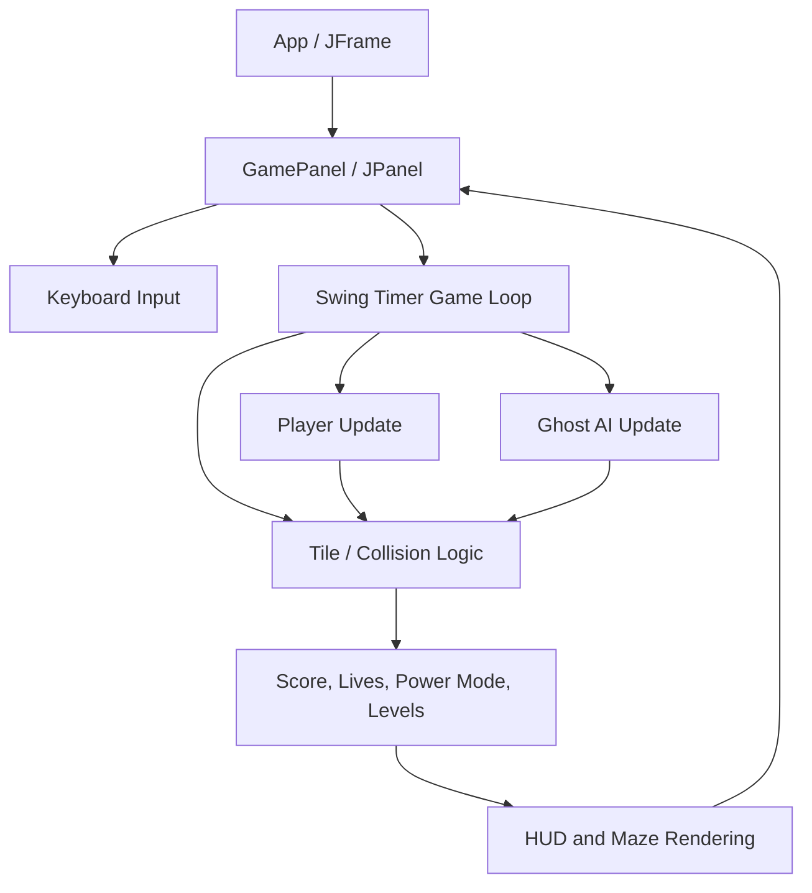

# System Architecture

## Main modules
- **App**: application entry point and window creation.
- **GamePanel**: owns the map, timer, game state, camera, collision checks, HUD, and screens.
- **Player**: direction buffering, movement, and player rendering.
- **Ghost**: heuristic movement, chase/flee decisions, respawn, and rendering.
